<p align="center">
  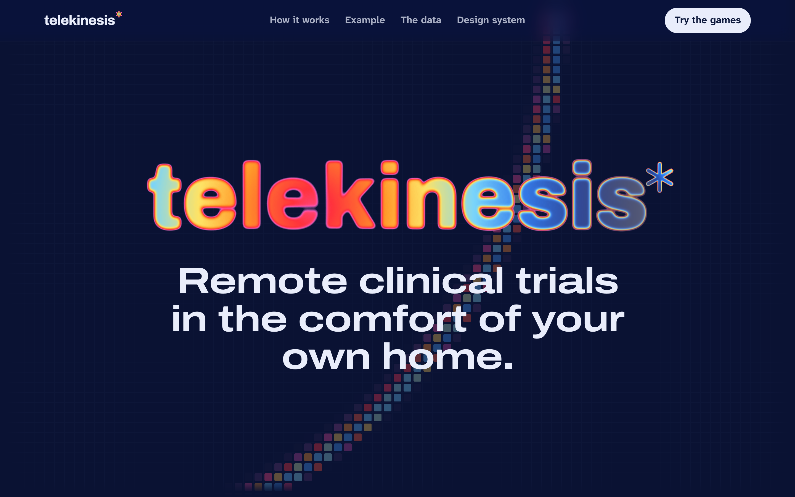
</p>

<p align="center">
  <a href="https://telekinesis-delta.vercel.app"></a>
  &nbsp;
  <a href="https://telekinesis-delta.vercel.app/play"></a>
</p>

<p align="center">
  <sub><b>BUILT WITH</b></sub><br>
  
  
  
  
  
  
  
</p>

<p align="center">
  <sub><b>BUILT FOR</b></sub><br>
  
  
</p>

---

Telekinesis turns a living room into a trial site. Clinical trials in Parkinson's, ALS, muscular dystrophy and stroke depend on how well people move, but that gets measured at a handful of clinic visits a year and rated by eye. Telekinesis replaces the gaps between visits with short movement games. Participants play them with any webcam, and each game mirrors a test clinicians already use. The camera tracks the body in the browser, so only the measurements leave the device, never the video.

<table align="center">
  <tr>
    <td align="center"><h3>4 → 260</h3>clinic snapshots a year, against home sessions at five a week</td>
    <td align="center"><h3>&lt; 1 min</h3>for each game</td>
    <td align="center"><h3>0</h3>frames of video leave the device</td>
    <td align="center"><h3>&lt; 1 KB</h3>is all one session sends</td>
  </tr>
</table>

<p align="center"><sub>A single trial site visit costs about $3,562 (Moore et al., 2018). Home sessions cost the participant five minutes.</sub></p>

<p align="center">
  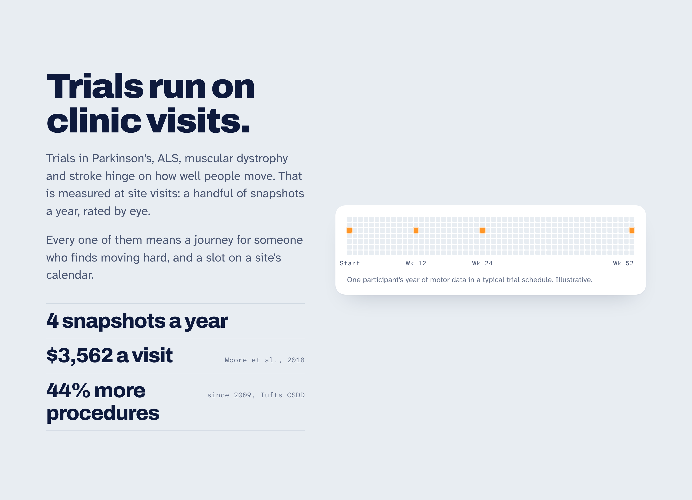
</p>

## The games

<p align="center">
  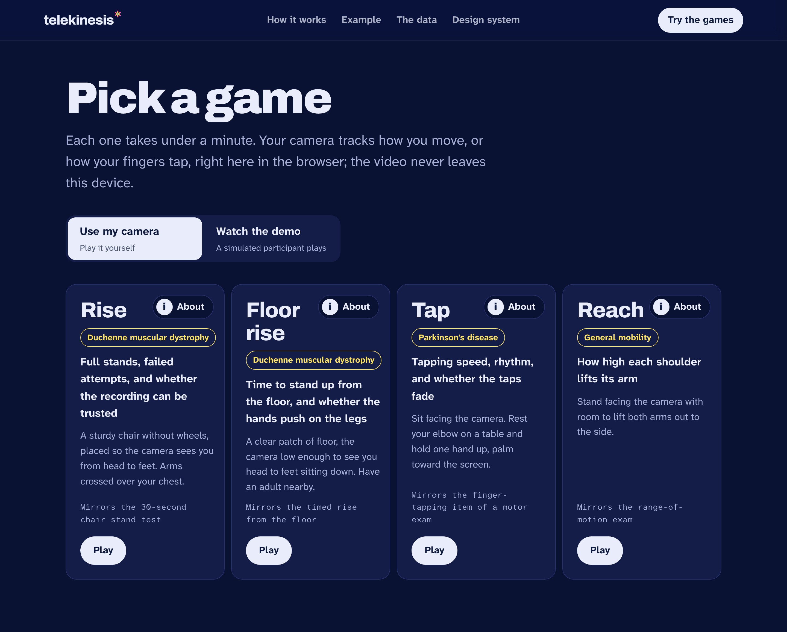
</p>

| | Game | For | What it measures | Mirrors |
| :-: | --- | --- | --- | --- |
| 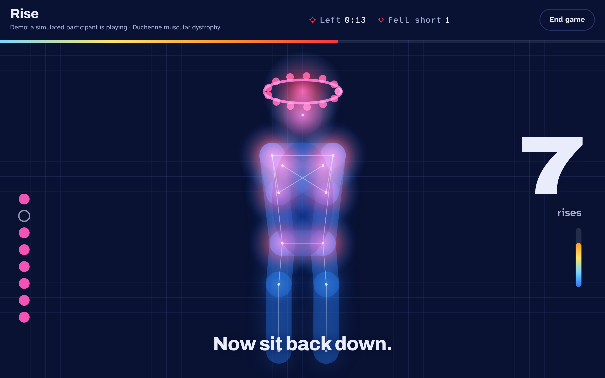 | **Rise** | Duchenne muscular dystrophy | Stand up from a chair as many times as you can in 30 seconds. Counts full stands, times each one, and logs rises that sink back. | The 30-second chair stand test |
| 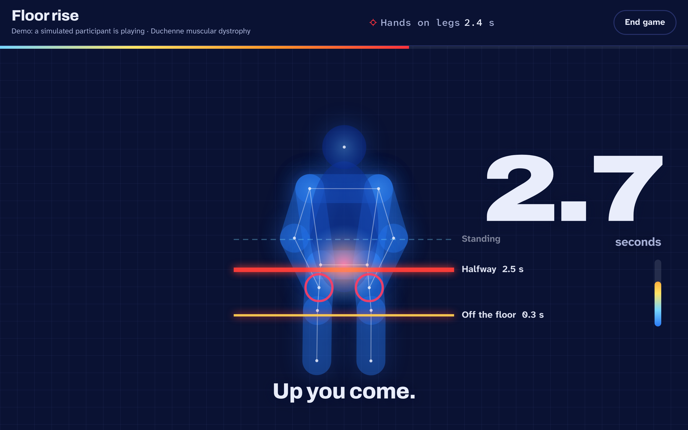 | **Floor rise** | Duchenne muscular dystrophy | Rise from sitting on the floor to standing. Times each stage and how long the hands push on the legs, a classic sign of Duchenne. | The timed rise from the floor (North Star Ambulatory Assessment) |
| 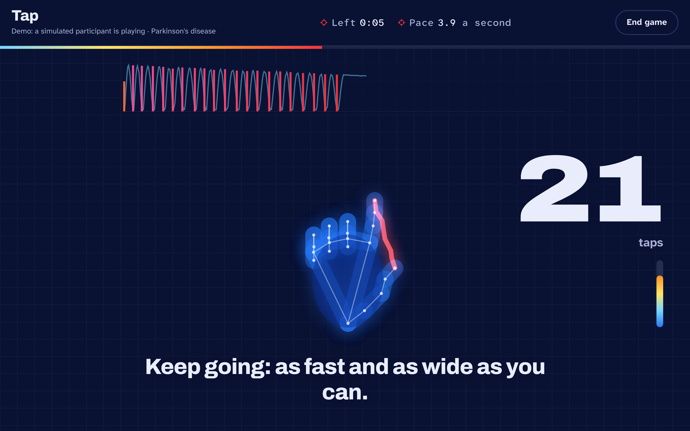 | **Tap** | Parkinson's disease | Tap finger and thumb as fast and as wide as you can for 10 seconds. Tracks speed, rhythm, and whether taps shrink or slow down. | The finger-tapping item of the MDS-UPDRS motor exam |
| 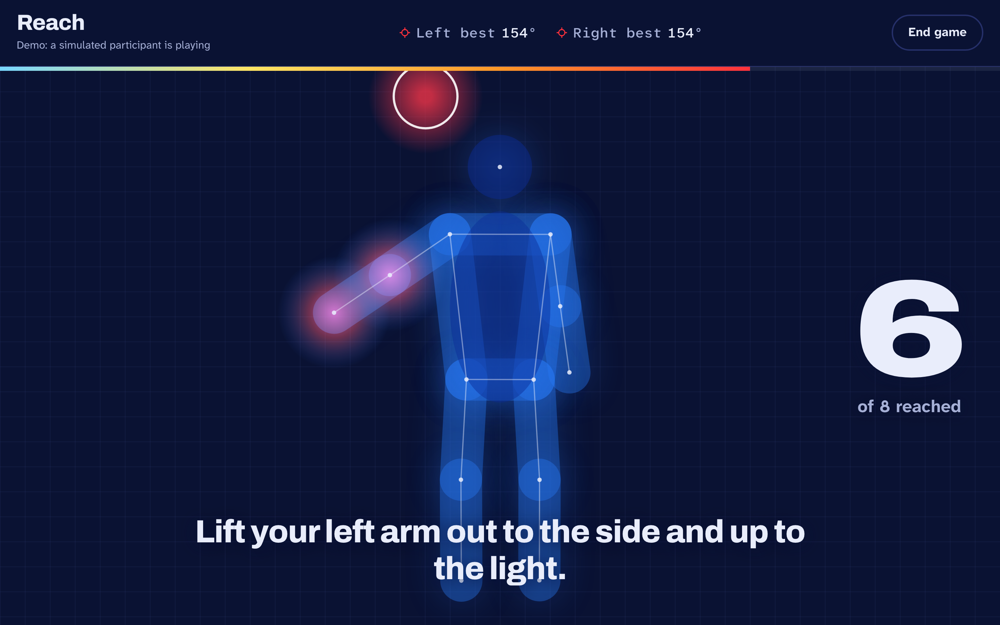 | **Reach** | General mobility | Lift each arm out to the side and up to the light. Measures how high each shoulder can raise its arm, left and right separately. | The range-of-motion exam |

Every game also runs in demo mode, where a simulated participant plays it, so you can see the full loop without standing up.

## How it works

| | Step | What happens |
| :-: | --- | --- |
| 1 | **Pick a game** | Each one takes under a minute and needs nothing but the laptop or TV the participant already owns. |
| 2 | **Track the body in the browser** | MediaPipe's pose landmarker (or its hand landmarker for Tap) runs on-device, on the GPU when it can. The video never leaves the room. |
| 3 | **Measure, not record** | The game turns joint positions into the numbers the clinical test cares about: stands and stand times, rise phases, tap pace and amplitude, shoulder angles. |
| 4 | **Check the recording** | Separate checks ask whether the recording can be trusted: whole body in view, close enough, steady camera, arms crossed for Rise, 15+ frames a second. A failed check doesn't change the score. It marks the session for a person to look at. |
| 5 | **Send the session** | A session is a small JSON record of measurements and quality flags, and the result screen shows exactly what it holds. This build keeps sessions in the browser's storage, standing in for the trial's server. |

<p align="center">
  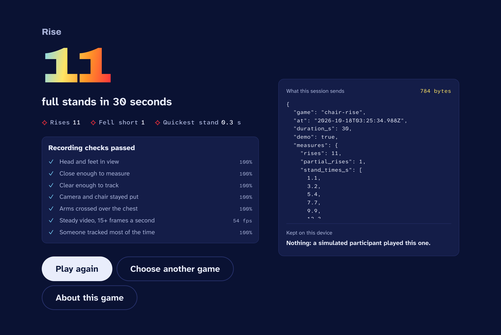
</p>

> [!NOTE]
> The participant dashboard and digital-twin comparison on the landing page show where this goes next: each participant is their own baseline, and the study team sees, week by week, how they're doing against a prediction of the untreated course. They're illustrations, not part of this build.

<p align="center">
  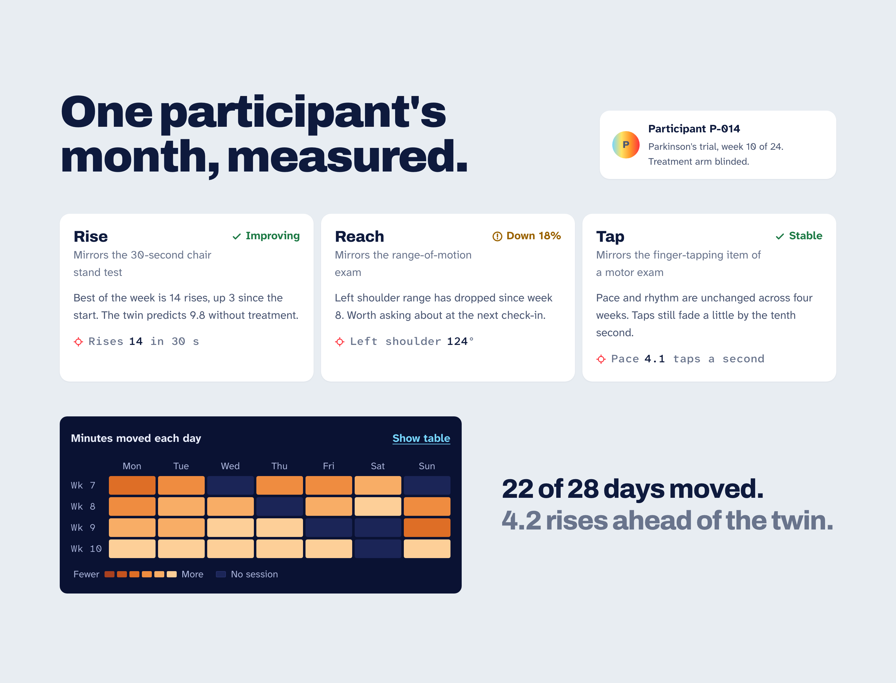
</p>

## The research behind it

Every game has an About page covering why the movement matters, how its data could help test a treatment, and the papers it builds on.

<p align="center">
  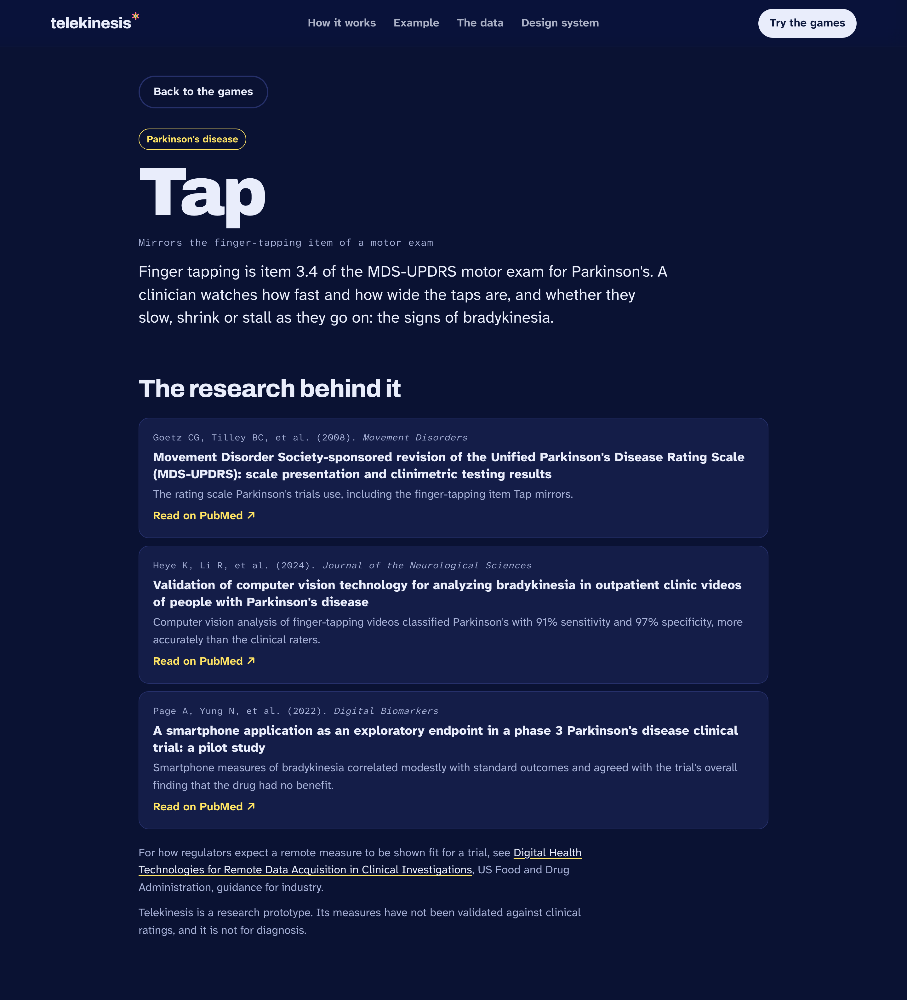
</p>

| Game | Builds on |
| --- | --- |
| Rise | Jones, Rikli & Beam (1999), the 30-s chair-stand test · McDonald et al. (2013), Duchenne trial endpoints and the smallest changes that matter clinically · Lowes et al. (2024), remote live-stream North Star scoring |
| Floor rise | Mazzone et al. (2010), North Star and timed items in Duchenne · Guglieri et al. (2022), the vamorolone randomized trial · Emery et al. (2022), remotely delivered and scored North Star |
| Tap | Goetz et al. (2008), the MDS-UPDRS · Heye et al. (2024), computer vision for bradykinesia in clinic videos · Page et al. (2022), a smartphone endpoint in a phase 3 Parkinson's trial |
| Reach | Mayhew et al. (2013), the Performance of the Upper Limb module for Duchenne · Han et al. (2015), 3D reachable workspace with Kinect |

For how regulators expect a remote measure to be shown fit for a trial, see the FDA's guidance, [*Digital Health Technologies for Remote Data Acquisition in Clinical Investigations*](https://www.fda.gov/regulatory-information/search-fda-guidance-documents/digital-health-technologies-remote-data-acquisition-clinical-investigations).

<p align="center">
  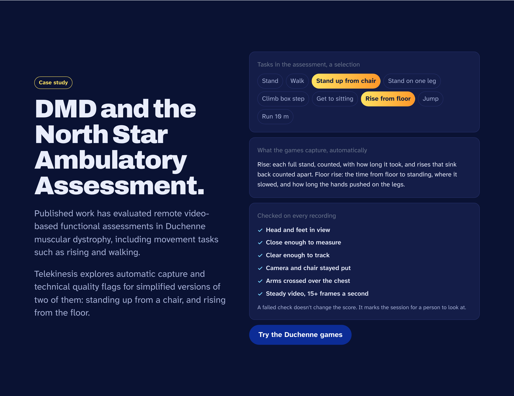
</p>

> [!IMPORTANT]
> Telekinesis is a research prototype. Its measures haven't been validated against clinical ratings, and it isn't for diagnosis.

## Tech stack

| Layer | Technology |
| --- | --- |
| Frontend | React 19, Vite, TypeScript, Motion |
| Body and hand tracking | MediaPipe Tasks Vision: pose landmarker (lite) and hand landmarker, in the browser |
| Game logic | Pure TypeScript controllers per game, with a simulated participant for demo mode |
| Tests | Vitest |
| Hosting | Vercel |

## Run it

```sh
npm install
npm run dev        # http://localhost:5173
```

There are no keys and no backend. Open `/play` and choose **Use my camera** to play yourself, or **Watch the demo** to see a simulated participant play. The camera needs `localhost` or HTTPS.

## Scripts

| Command | What it does |
| --- | --- |
| `npm run dev` | Runs the app |
| `npm run build` | Type-checks and builds to `dist/` |
| `npm run preview` | Serves the production build |
| `npm test` | Runs the unit tests |
| `npm run lint` | Lints with oxlint |

## Layout

| Path | What it holds |
| --- | --- |
| `src/pages/` | The landing page (`/`), the games (`/play`) and the design system (`/design`) |
| `src/play/` | Camera and tracker setup, the game runner, results, About pages, quality checks and the session record |
| `src/play/games/` | One module per game: Rise, Floor rise, Tap and Reach |
| `src/play/research.ts` | Each game's rationale and its citations |
| `src/components/` | Shared UI: the thermal figure, heatmaps, charts and nav |
| `src/styles/` | The design system: everything cold until it moves |

---

<p align="center">
  <a href="https://telekinesis-delta.vercel.app"><b>telekinesis-delta.vercel.app</b></a>
</p>
